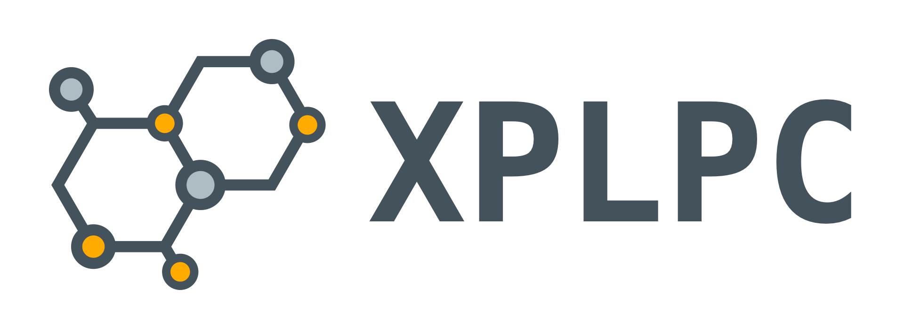
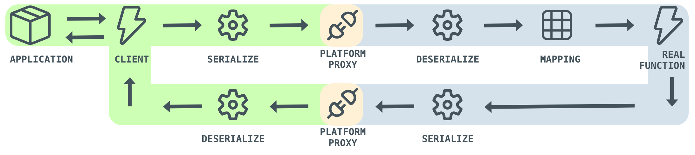

<p align="center">
    <a href="https://github.com/xplpc/xplpc" target="_blank" rel="noopener noreferrer">
        
    </a>
    <br>
    XPLPC - Cross Platform Lite Procedure Call
    <br>
</p>

<p align="center">
    <a href="https://github.com/xplpc/xplpc/actions/workflows/c.yml"></a>
    <a href="https://github.com/xplpc/xplpc/actions/workflows/cxx.yml"></a>
    <a href="https://github.com/xplpc/xplpc/actions/workflows/kotlin-desktop.yml"></a>
    <a href="https://github.com/xplpc/xplpc/actions/workflows/kotlin-android.yml"></a>
    <a href="https://github.com/xplpc/xplpc/actions/workflows/swift.yml"></a>
    <a href="https://github.com/xplpc/xplpc/actions/workflows/wasm.yml"></a>
    <a href="https://github.com/xplpc/xplpc/actions/workflows/flutter.yml"></a>
    <a href="https://github.com/xplpc/xplpc/actions/workflows/python.yml"></a>
    <a href="https://github.com/xplpc/xplpc/actions/workflows/docs.yml"></a>
</p>

## Project

The XPLPC project connects languages and platforms, allowing for the transfer of serialized data between them. This is achieved without the need for a server, but instead by utilizing device memory. This approach is known as Lite Procedure Call.

One router lives in the C++ core for the whole process, and every language attaches to it as a layer. A layer registers the function names it serves, and a call from any language reaches the layer that registered that name last, so C++ can serve a name, an Android layer can take it over and a Flutter layer can take it from both, and when the Flutter layer goes away the name goes back to Android. Large buffers cross as a handle to bytes their owner registered, so they are neither copied nor encoded.

For example, you can call a procedure written in C++ code from a mobile application, or vice versa, with ease. This opens up a wide range of possibilities for developers and allows for a more seamless integration of different languages and platforms.

The XPLPC project needs no generator for the calls themselves, since a mapping is registered by name in plain code on every side. The one exception is Flutter, where filling an answer into a class of yours needs the reflection data reflectable's builder generates, which the Flutter guide describes. The library is added to an existing project without rewriting its code.

## Using it from your own project

You do not need to copy this repository to build on it. Add it to your own CMake project with `FetchContent` or `add_subdirectory`, put your mappings into the `xplpc` target, define `NativeLayer::initializePlatform` to register them, and link `xplpc::xplpc`, and taking an update is moving one tag:

```cmake
include(FetchContent)

FetchContent_Declare(xplpc GIT_REPOSITORY https://github.com/xplpc/xplpc.git GIT_TAG main-<commit>)
FetchContent_MakeAvailable(xplpc)

target_sources(xplpc PRIVATE src/NativeLayer.cpp)
target_link_libraries(app PRIVATE xplpc::xplpc)
```

[`cxx/consumer`](cxx/consumer) is a complete project built that way, and the [C++ guide](docs/cxx.md) describes the options a consumer sets.

## Workflow

<p align="center">
    <a href="https://github.com/xplpc/xplpc" target="_blank" rel="noopener noreferrer">
        
    </a>
</p>

## How to use

Using C++ code:

```cpp
auto request = Request{
    "sample.login",
    Param<std::string>{"username", "paulo"},
    Param<std::string>{"password", "123456"},
    Param<bool>{"remember", true},
};

Client::call<std::string>(request, [](const auto &response) {
    std::cout << "Returned Value: " << (response ? response.value() : "Empty") << std::endl;
});
```

Using Kotlin code:

```kotlin
val request = Request(
    "sample.login",
    Param("username", "paulo"),
    Param("password", "123456"),
    Param("remember", true)
)

Client.call<String>(request) { response ->
    println("Returned Value: $response")
}
```

Using Swift code:

```swift
let request = Request(
    "sample.login",
    Param("username", "paulo"),
    Param("password", "123456"),
    Param("remember", true)
)

Client.call(request) { (response: String?) in
    print("Returned Value: \(response ?? "")")
}
```

Using WASM with Typescript:

```typescript
const request = new Request(
    "sample.login",
    new Param("username", "paulo"),
    new Param("password", "123456"),
    new Param("remember", true),
);

Client.call<string>(request).then((response : string | undefined) => {
    console.log("Returned Value: " + response);
});
```

Using Flutter with Dart:

```dart
var request = Request("sample.login", [
    Param("username", "paulo"),
    Param("password", "123456"),
    Param("remember", true),
]);

Client.call<String>(request, (response) {
    print("Returned Value: $response");
});
```

Using Python code:

```python
request = Request(
    "sample.login",
    [
        Param("username", "paulo"),
        Param("password", "123456"),
        Param("remember", True),
    ],
)

Client.call(request, lambda response: print(f"Returned Value: {response}"), str)
```

Every language but C also has a waiting form of the same call, which is `callAsync`, or `call_async` in Python, and TypeScript has none of its own because `call` already answers with a promise. And every language has `callSync`, or `call_sync` in Python, which answers with the value itself when the mapping answered before it returned, and with the empty value when it did not. The guide for each language describes both, and the C guide shows the same thing done by hand over `xplpc_call` and `xplpc_cancel`.

## Supported languages and platforms

* C
* C++
* Kotlin (Android, Desktop)
* Swift (iOS, macOS, tvOS, watchOS, Catalyst)
* WebAssembly
* Flutter (iOS, Android, Desktop)
* Python

## Documentation

* [General](docs/general.md)
* [Types](docs/types.md)
* [C](docs/c.md)
* [C++](docs/cxx.md)
* [Kotlin](docs/kotlin.md)
* [Swift](docs/swift.md)
* [WebAssembly](docs/wasm.md)
* [Flutter](docs/flutter.md)
* [Python](docs/python.md)
* [Dependency Manager](docs/dependency-manager.md)
* [Contribution](docs/contribution.md)
* [Purpose](docs/purpose.md)

## License

[MIT](http://opensource.org/licenses/MIT)

Copyright (c) 2022-2026, Paulo Coutinho
