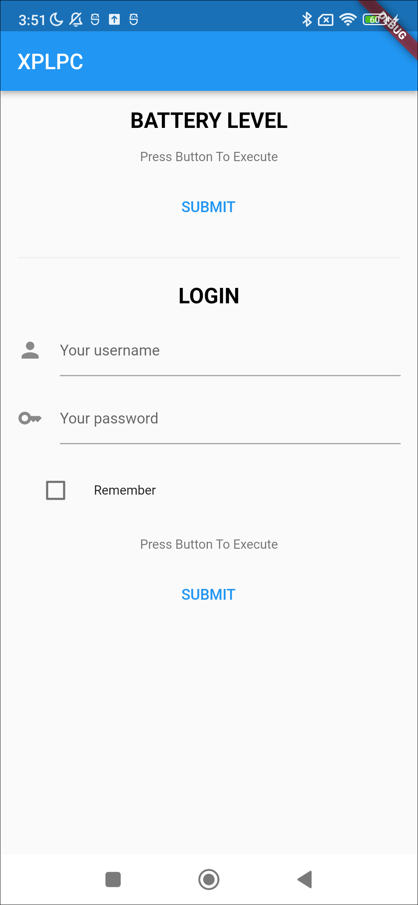
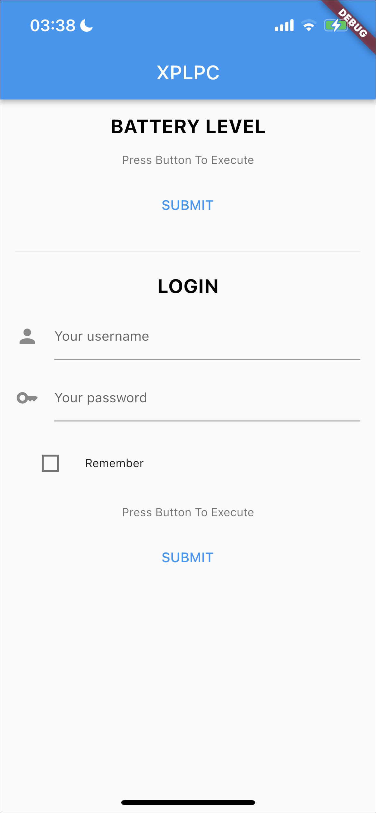
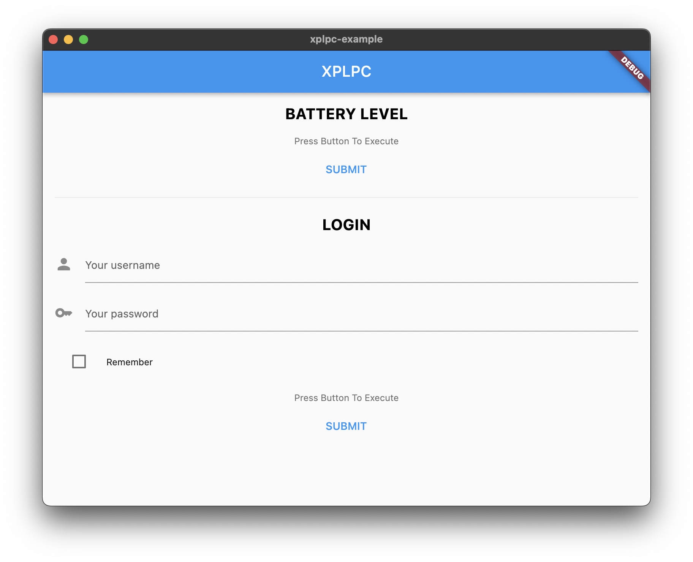
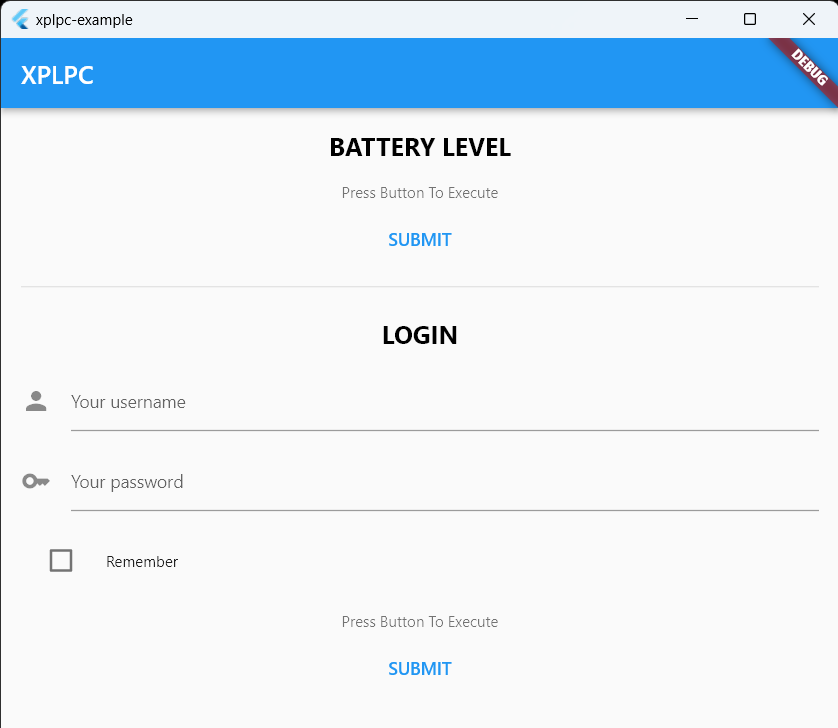
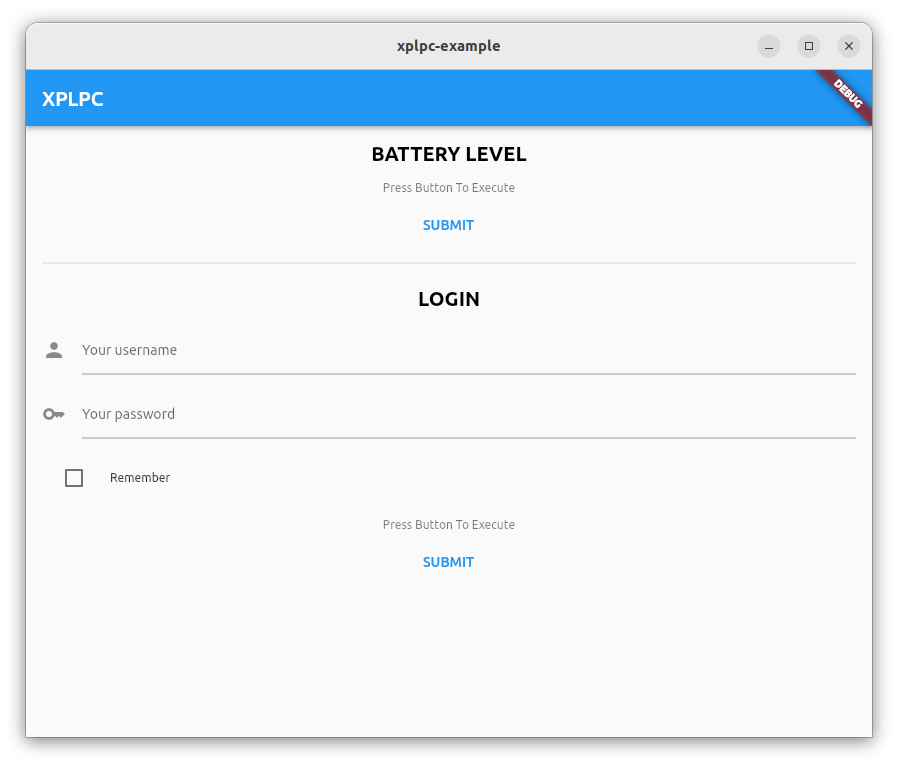

# Flutter

Flutter is a versatile platform that supports a wide range of operating systems, including iOS, Android, macOS, Linux and Windows.

To ensure seamless integration with these diverse environments, developers are required to build XPLPC with interface support that allows for direct C function calls from Dart.

This interface support is essential for ensuring that your Flutter app can take full advantage of the powerful features offered by C functions, such as enhanced performance and optimized memory usage.

With XPLPC and interface support, developers can easily create cross-platform applications that run seamlessly on a range of operating systems and deliver a consistent user experience across all devices.

Whether you're developing for mobile or desktop, Flutter with XPLPC provides a powerful and flexible framework that empowers developers to create robust and performant applications.

## Supported platforms

We currently support these Flutter platforms:

* Android
* iOS
* macOS
* Linux
* Windows

Web is not supported, since the plugin reaches the library through `dart:ffi`.

The plugin needs Flutter 3.50 and Dart 3.14. The framework it vendors is built for iOS 15 and macOS 12, which are the oldest versions the current Xcode builds for, and the plugin declares Android sdk 24 as its minimum.

On iOS and macOS the framework reaches your application through Swift Package Manager, which is what Flutter uses by default. A project that turned Swift Package Manager off receives the same framework through the podspec, so both integrations keep working.

## How to build the native library for Android

Execute on terminal:

```
python3 xplpc.py kotlin-build --interface --platform flutter
python3 xplpc.py kotlin-build-aar --platform flutter
```

The plugin does not carry the native library on Android, so the application module links the aar the build wrote to `build/kotlin-aar-flutter`. An aar file carries no dependency metadata, so the two libraries the kotlin layer uses are named beside it, or a release build stops at R8 on the missing classes. In `android/app/build.gradle.kts`, with the path naming the aar in your own checkout:

```
dependencies {
    implementation(files("/path/to/xplpc/build/kotlin-aar-flutter/library-release.aar"))
    implementation("com.google.code.gson:gson:2.15.0")
    implementation("org.jetbrains.kotlinx:kotlinx-coroutines-core:1.11.0")
}
```

Every native build here carries this repository's sample C++ mappings unless it is given `--custom-data-path` naming a directory of your own, as the C++ guide describes.

## How to build the native library for iOS

Execute on terminal:

```
python3 xplpc.py swift-build --interface --platform ios-flutter
python3 xplpc.py swift-build-xcframework --platform ios-flutter
```

## How to build the native library for macOS

Execute on terminal:

```
python3 xplpc.py swift-build --interface --platform macos-flutter
python3 xplpc.py swift-build-xcframework --platform macos-flutter
```

## How to build the native library for Linux

Execute on terminal:

```
python3 xplpc.py c-build-shared
```

## How to build the native library for Windows

Execute on terminal:

```
python3 xplpc.py c-build-shared
```

## Setup your project

The plugin is a path dependency on the checkout where the native library was built, since its Linux and Windows builds find `build/c-shared` relative to the plugin and its iOS and macOS packages read the xcframework link `swift-build-xcframework` writes beside it. A git or hosted dependency has no build directory to find. In your `pubspec.yaml`:

```yaml
dependencies:
  xplpc:
    path: /path/to/xplpc/flutter/plugin
```

A call that answers a plain value, which is a string, a number, a boolean, a list or a map, needs nothing more than the plugin. Reading an answer into a class of your own does, since Flutter is compiled without `dart:mirrors` and the serializer fills that class through the `fromJson` constructor it declares, which it finds through reflectable (https://github.com/google/reflectable.dart).

A program that never initializes reflectable reads plain values exactly the same way, so these steps are only for the classes you want filled:

1. Add the reflectable dependencies in your `pubspec.yaml` file:

```yaml
dependencies:
  reflectable: ^5.2.3

dev_dependencies:
  build_runner: ^2.16.1
  reflectable_builder: ^1.2.3
```

`reflectable_builder` 1.2.3 depends on analyzer 13 and `build_runner` moved to analyzer 14 in 2.16.2, so 2.16.1 is the newest `build_runner` the two resolve with.

2. Add your Dart file that contains the `main` method in the `build.yaml` file, like this: `flutter/plugin/example/build.yaml`. Create or copy the `build.yaml` file to your project root.
3. Run `build_runner` to generate `reflectable` files ignored for git with this command in your project root folder: `dart run build_runner build`.
4. Initialize reflectable library in your `main` method like this:

```dart
// This file is generated in step 3.
import 'main.reflectable.dart';

void main() {
  initializeReflectable();
}
```

5. Annotate every class that you will use with XPLPC with `@reflector`, imported from `package:xplpc/reflectable/reflector.dart`, and give it a `fromJson` constructor, like this class: `flutter/plugin/lib/type/dataview.dart`.

## How to run the Flutter tests

The suite drives the real native library, so it has to be built first:

```
python3 xplpc.py swift-build --interface --platform macos-flutter
python3 xplpc.py swift-build-xcframework --platform macos-flutter
python3 xplpc.py flutter-test
```

On Linux and Windows the suite reads the shared library instead, so build it with `python3 xplpc.py c-build-shared`.

## How to format the Dart code

Execute on terminal:

```
python3 xplpc.py flutter-format
```

## Bringing the library up

Reflectable is initialized first, as the setup above describes, and then the library is given the serializer it carries:

```dart
void main() {
  initializeReflectable();

  XPLPC.instance.initialize(Config(JsonSerializer()));

  Mapping.instance.initialize();

  runApp(const MyApp());
}
```

Initializing opens the native library and attaches the isolate to the router as a layer. The router itself is built the first time anything uses it and lives until the process ends, with the C++ mappings registered before any host attaches. `Mapping` is the example application's own class, and it registers that application's mappings the way the next section shows.

A call made before `initialize` is reported once by name and answered with `null`, or the empty string for a call from a document.

The native library is found by the platform it runs on, which is the application bundle on iOS and macOS, `libxplpc.so` on Android and Linux and `xplpc.dll` on Windows. `XPLPC_LIBRARY_PATH` names a file to open instead, which is what serves a desktop application that ships the library somewhere the loader does not search.

## Registering a mapping

A mapping is registered by name, which is what makes it reachable from any other language:

```dart
MappingList.instance.add(
  "platform.battery.level",
  MappingItem(batteryLevel),
);
```

Registering declares the name to the router, so registering before the library is up writes one line and raises a `StateError` saying it was not initialized, rather than registering into a layer that is not there. `MappingList.instance.clear()` takes back every name the isolate registered.

## The last registration wins

Every language registers into the same router, so when two of them register the same name, the one that registered it last receives every call to it. Taking a registration back gives the name to the layer that registered it before.

The C++ mappings are registered before any host attaches. C++ can serve `http.request`, an Android layer can register the same name and take it over, and a Flutter layer in that application can take it from both. When the Flutter layer goes away the name goes back to Android, and when Android takes its registration back the name goes back to C++.

## One isolate owns the layer

The isolate that brings the library up is the layer. A call to a mapping it registered enters it directly when the call arrives on the isolate's own thread inside a call the isolate made, and reaches it through its event loop otherwise, since an isolate cannot be entered from a thread it does not own. An answer produced on another thread reaches it the same way.

The isolate attaches under the name `dart`, and an isolate that brings the library up in a process where another one already did takes its place. The isolate it replaces is never reached again, its names go back to the layer that registered them before, and the calls it was still waiting on are never answered, since the runtime that would receive the answers is gone. That is what keeps a hot restart working.

An isolate that ends leaves the router the same way, without waiting for another one to attach. Every callable it registered dies with it, so the plugin abandons its layer from a finalizer the isolate runs as it shuts down, which is what an Android activity finishing while the process stays alive looks like. Its names go back to the layer below, the calls it was serving are answered with the empty value, and an answer that arrives later for a call it made is dropped instead of entering a callback that no longer exists.

So bring the library up on one isolate and call it from there. Work you hand to `compute` or to an `Isolate.spawn` sends its request back to that isolate rather than reaching the library itself.

## Making a call

There are three ways to make a call and they differ in how the answer reaches you.

`call` hands the answer to a callback:

```dart
var request = Request("sample.login", [
    Param("username", "paulo"),
    Param("password", "123456"),
    Param("remember", true),
]);

Client.call<String>(request, (response) {
    print(response);
});
```

`callAsync` hands it to what the language waits on:

```dart
final response = await Client.callAsync<String>(request);
print(response);
```

`callAsync` always gives control back before the answer arrives. `call` returns before the answer whenever the mapping needs time, and runs the callback before it returns when the mapping answered at once.

An answer produced on a thread the isolate does not own reaches you through a `NativeCallable.listener`, which queues it onto the event loop. That is part of the plugin and needs nothing from you.

`callSync` answers with the value itself, and `callSyncFromString` takes the encoded request:

```dart
final response = Client.callSync<String>(request);
print(response);
```

It reads an answer that is already there rather than waiting for one, so it works only when the mapping answers before it returns. A call the mapping had not answered by then is cancelled and reported, so its later answer resolves nothing, and you are answered the empty value. It never blocks a thread, which is why there is no timeout to pass and no deadlock to reach.

Whether a mapping answers before it returns belongs to the mapping rather than to the call site, and that mapping may be written in another language by somebody else. A call that works today answers empty the day that mapping starts doing real work, so `callSync` is for reading something you know is a plain read.

The empty value is also what a mapping with nothing to answer produces, so the two are told apart by the log and not by the value.

## Making the same call from a document

Every entry point has a second form that takes the request already serialized and answers the
response document rather than a decoded value. It is what serves a host that received a document
from somewhere else and has nothing to decode it against, which is how the bridges themselves call
in.

The difference in the answer is the whole of it. A typed call says a value is absent the way this
language says it, and a call from a document answers the empty string, since a document is either
there or it is not.

```dart
Client.callFromString(requestData, (response) {
    print(response);
});

final answer = Client.callSyncFromString(requestData);

final awaited = await Client.callAsyncFromString(requestData);
```

## When no mapping answers

Every call is answered exactly once, and a call no mapping can answer is answered with the empty value rather than left waiting:

| Situation | What the caller receives |
| --- | --- |
| No layer registered the name | The empty value at once, and the failure is reported |
| The request could not be read | The empty value at once, and the failure is reported |
| The mapping raised before it returned | The empty value, and the failure is reported |
| The layer serving the call detached | The empty value, and the name goes back to the layer that registered it before |
| The call was cancelled | Nothing through a callback, since a cancelled call never calls back, and `callSync` answers the empty value |

A future cannot be cancelled, so the one Dart call that is cancelled is `callSync` when the mapping had not answered.

## Writing a mapping

A mapping is handed a message and something to answer through, and the one rule is to return quickly. Where the work runs is your decision.

Answering right away is fine when there is nothing slow to do:

```dart
void batteryLevel(Message m, Response r) {
  r("100${m.get<String>("suffix") ?? ""}");
}
```

Anything that takes time is started and left running, and the answer is given when it finishes, whether it succeeded or not:

```dart
void ip(Message m, Response r) {
  http.get(Uri.parse("https://httpbin.io/ip")).then(
    (response) => r(response.body),
    onError: (Object _) => r(null),
  );
}
```

An isolate runs on one thread, so a mapping that waits instead of returning holds that thread and everything on it. Starting the work and returning is what keeps the interface responsive.

The plugin answers the caller when a mapping raises before it returns, and it cannot see a future the mapping left behind. A mapping declared `async`, or one that answers from a `then`, has to answer on the failing path itself, since a future that raises later is one nobody is listening to and the caller would wait for the life of the process.

Reading a value names the type you want, and a value of another type answers `null` and is reported. Json has one kind of number, so an integer is read as a `double` whenever the double holds it exactly, a fraction is never read as an `int`, a number is never a `bool` and text is never a number. An integer literal past what a Dart `int` holds is already a rounded double when `json.decode` hands it over, so reading it as a `double` answers the rounded value, which the other typed bridges refuse. A request that names the same parameter twice, or carries a parameter whose name is not text, is refused before any mapping runs, since the two values would mean different things to different bridges. The [types guide](types.md) has every type and what each language reads it as.

## Sending a large buffer

A `DataView` names a buffer by a handle, so a large buffer crosses without being copied or encoded, and the wire carries `{"buffer":<handle>}` and never an address. Which of the two constructors you use decides who frees the memory. `createFromByteBuffer` registers native memory you own and keep valid until the view is disposed, and `allocateFromByteArray` copies into native memory the view owns and frees when it is disposed. Either way `dispose` releases the registration:

```dart
final view = DataView.allocateFromByteArray(bytes);

try {
  final request = Request("sample.image.grayscale.dataview", [Param("dataView", view)]);
  final response = await Client.callAsync<String>(request);

  print(response ?? "");
} finally {
  view.dispose();
}
```

The view is released only once the call answered, which is why the call is awaited. `Client.call` returns as soon as the request is handed over, so releasing a view right after it frees memory a mapping that answers later is still reading. The same holds after `callSync` gave up on a mapping that had not answered, since that cancels the call without stopping the mapping.

Reading one goes through `ByteArrayHelper`, which answers a copy of the bytes while their owner keeps them registered, and an empty list for a view whose buffer was released, was never registered or carries a handle that names nothing any more, and reports the refusal:

```dart
final processed = ByteArrayHelper.createFromDataView(view);
```

Only the side that registered a buffer can release it, so `dispose` answers false for a view you received, and a mapping that answers with a view keeps it registered after it returns, since the caller reads it once the call has unwound.

## Logging

The library reports every failing path. An error names what failed and where, and is always reported. A debug line carries the reason behind it, including the message the parser produced, and is off until you ask for it.

The library writes to a `package:logging` logger named `XPLPC`, and your application decides the level and where it goes:

```dart
import 'package:logging/logging.dart';

hierarchicalLoggingEnabled = true;

Logger('XPLPC').level = Level.ALL;

Logger.root.onRecord.listen((record) {
  debugPrint('${record.loggerName}: ${record.level.name}: ${record.message}');
});
```

Setting the level on a named logger needs `hierarchicalLoggingEnabled`, which is what lets you raise this library without raising your own. Without a listener nothing is printed, which is how `package:logging` works for every logger.

## Sample project

Before using the sample you need:

1. Build the `native library` for your platform first.
2. Run the `build_runner` inside example folder:

   ```
   cd flutter/plugin/example
   flutter pub get
   dart run build_runner build
   ```

You can see the sample project in directory `flutter/plugin/example`.

To run the sample execute:

```
cd flutter/plugin/example
flutter run
```

Or you can specify the device/platform:

```
cd flutter/plugin/example
flutter run -d windows
```










