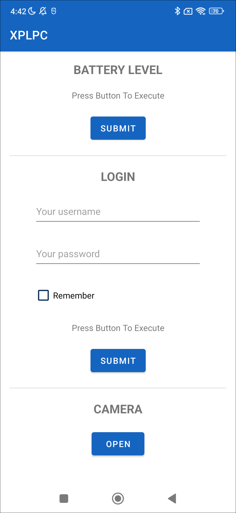
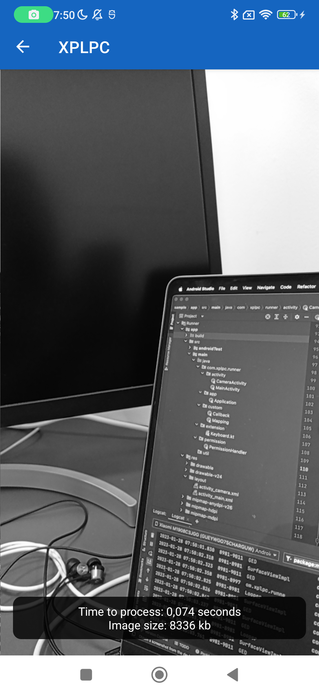
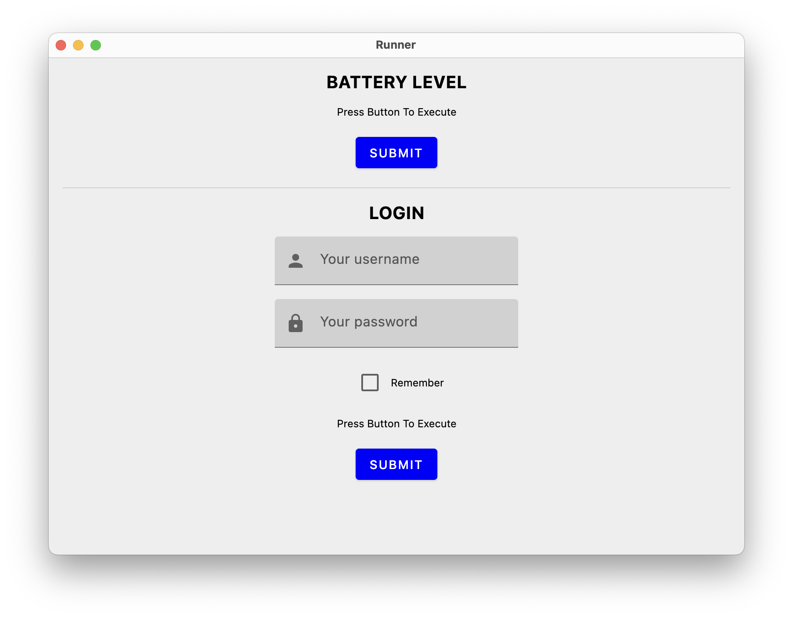
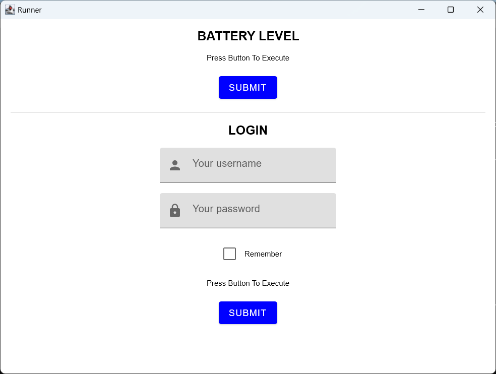
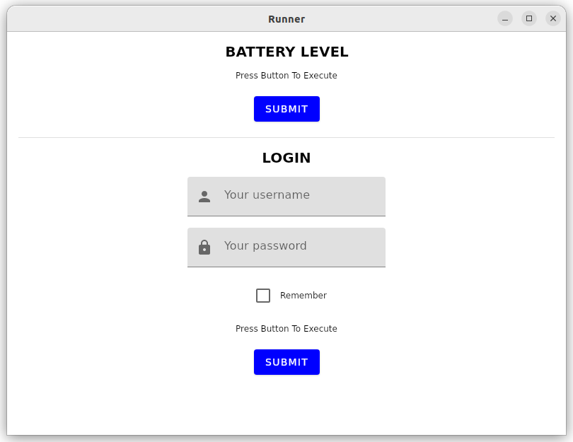

# Kotlin

Kotlin support on XPLPC allows you to build, run, and test samples for both Android and Desktop platforms.

When executing the commands, simply pass the `--platform android` or `--platform desktop` parameter.

Disable `wildcard` imports in your IDE (Preferences > Editor >Code Style > Kotlin > Imports):

* Top-Level Symbols: Use single name import
* Java Static and Enum Members: Use single name import
* Packages to Use Import with '\*': Delete all rows

## Requirements for Android

* Java 25 to build, and the library runs on Java 17 or later, since its bytecode targets 17 whatever jdk builds it
* Android NDK r28 or later, which the workflows and the modules name as `30.0.16248370` (if you are using `CPM` as your package manager)

If you are using `CPM` as your package manager, you will need to manually install the `Android NDK` and set the `ANDROID_NDK_ROOT` environment variable to the root folder of the NDK after installation.

An NDK before r28 aligns the library to four kilobytes, which a device with sixteen kilobyte pages refuses to load, so the build refuses one.

To download the NDK, please visit the following link: https://developer.android.com/ndk/downloads

## How to build a Kotlin library for Android

Execute on terminal:

```
python3 xplpc.py kotlin-build --platform android
```

The task builds the four abis the aar packages, which are `armeabi-v7a`, `arm64-v8a`, `x86` and `x86_64`, each into a directory of its own under `build/kotlin-android`, and the aar build refuses to start while any of them is missing.

## How to build the AAR package for Android

Execute on terminal:

```
python3 xplpc.py kotlin-build-aar --platform android
```

or

```
cd kotlin/android/lib
./gradlew clean :library:build
```

The task copies the aar to `build/kotlin-aar-android/library-release.aar`. It carries no dependency metadata, so the application that links it declares the two libraries it needs beside it:

```
implementation files('/path/to/xplpc/build/kotlin-aar-android/library-release.aar')
implementation 'com.google.code.gson:gson:2.15.0'
implementation 'org.jetbrains.kotlinx:kotlinx-coroutines-core:1.11.0'
```

To enable C interface you can use:

```
python3 xplpc.py kotlin-build --interface --platform android
python3 xplpc.py kotlin-build-aar --platform android
```

## Requirements for Desktop

* Java 25 to build, and the library runs on Java 17 or later, since its bytecode targets 17 whatever jdk builds it

## How to build a Kotlin library for Desktop

Execute on terminal:

```
python3 xplpc.py kotlin-build --platform desktop
```

or

```
cmake -S . -B build/kotlin-desktop/<arch> -DXPLPC_TARGET=kotlin -DXPLPC_ADD_CUSTOM_DATA=ON
cmake --build build/kotlin-desktop/<arch>
```

The `<arch>` directory is `arm64` or `x86_64`, matching the machine, since that is where the jar build and the suite read the native library from.

## How to build the JAR package for Desktop

Execute on terminal:

```
python3 xplpc.py kotlin-build-jar --platform desktop
```

or

```
cd kotlin/desktop/lib
./gradlew clean jar -P xplpc_arch=<arch>
```

The task copies the jar to `build/kotlin-jar-desktop`. It carries no dependency metadata, so the application that uses it declares the two libraries it needs beside it:

```
implementation files('/path/to/xplpc/build/kotlin-jar-desktop/xplpc.jar')
implementation 'com.google.code.gson:gson:2.15.0'
implementation 'org.jetbrains.kotlinx:kotlinx-coroutines-core:1.11.0'
```

## How to build and run the Kotlin sample

Execute on terminal:

```
python3 xplpc.py kotlin-build-sample --platform desktop
python3 xplpc.py kotlin-run-sample --platform desktop
```

## How to run the Kotlin tests

Execute on terminal:

```
python3 xplpc.py kotlin-test --platform desktop
```

This task does not build the native library, so a change under `cxx`, `c` or `jni` is only picked up after building it first, with `--platform android` for the device suite:

```
python3 xplpc.py kotlin-build --platform desktop
```

The Android tests run on a device or emulator:

```
python3 xplpc.py kotlin-test --platform android
```

Both read the same sources, in `kotlin/shared/tests`, so a test cannot exist on one platform and not the other. What stays per project is `TestPlatform`, which brings XPLPC up, `ConformanceFiles`, which reads the shared cases from files on desktop and from test assets on a device, and on desktop `NativeLibTest`, which loads the library from a jar.

## How to format the Kotlin code

Execute on terminal:

```
python3 xplpc.py kotlin-format
```

## Build parameters

You can build this target using some parameters to change configuration:

**Your own C++ mappings in place of `cxx/custom`, read by `kotlin-build`, as the C++ guide describes:**

```
--custom-data-path=/path/to/your/mappings
```

**Build type:**

```
--build debug
```

**Enable C interface, read by `kotlin-build` for the android and flutter platforms:**

```
--interface
```

**Incremental, keeping what a previous build left:**

```
--incremental
```

**No dependencies:**

```
--no-deps
```

**Platform:**

```
--platform (android, desktop or flutter)
```

## Release builds on Android

The serializer builds the wire format by reading field names through reflection, which is what lets any type cross the bridge without an annotation or a generated adapter. R8 renames fields in a release build, so a type of yours that crosses the bridge stops being readable and the call silently carries the wrong parameters while every debug build keeps working.

The library ships `consumer-rules.pro` and it keeps what belongs to the library, which is the classes JNI resolves by name, the fields the serializer reads to build the wire format and the `kotlin.Metadata` annotation Kotlin reflection reads. It cannot keep your types, and a Kotlin class is filled through its primary constructor, which Kotlin reflection finds by the names the compiler recorded, so any class you send or receive needs its whole shape kept:

```proguard
-keep class com.yourapp.model.** { *; }
```

Build a release variant and make one call carrying such a type before shipping, since this is the one failure that never appears in a debug build.

The native library inside the aar keeps its debug information and the application strips it while it packages, so the library in the apk carries the build id of the one in the aar. A crash inside it is turned into a function, a file and a line from that unstripped copy, which Play receives when the application sets `debugSymbolLevel` and a crash reporter such as Crashlytics receives through its own native symbol upload:

```groovy
defaultConfig {
    ndk {
        debugSymbolLevel = 'full'
    }
}
```

## Bringing the library up

Bringing the library up loads the native library, which attaches Kotlin to the router as a layer. The router itself is built the first time anything uses it and lives until the process ends, and the C++ mappings are registered before Kotlin attaches.

On Android this happens on its own, through a content provider the manifest of the AAR already declares, so there is nothing to call. The debug level comes from the application's own debuggable flag.

On desktop nothing runs on its own, so the initializer is called before the first call. It answers whether the library came up, which is false when the native library could not be extracted or loaded. The reason is in the log, nothing is left half initialized and calling it again tries again:

```kotlin
import com.xplpc.platform.PlatformInitializer

if (!PlatformInitializer.initialize()) {
    // The native library is missing or does not match this machine.
}
```

The desktop jar carries the native library as a resource and extracts it into a directory of its own on every start, so two processes running different versions side by side never load each other's binary.

`XPLPC.initialize` answers the same thing on both targets, so on Android a load that failed shows up as `XPLPC.initialized` staying false rather than as a crash inside the content provider.

## Registering a mapping

A mapping is registered by name, which is what makes it reachable from any other language:

```kotlin
import com.xplpc.data.MappingList
import com.xplpc.map.MappingItem

MappingList.add("platform.battery.level", MappingItem(::batteryLevel))
```

Registering declares the name to the router, so it raises rather than registering into a layer that is not there when the native library has not been loaded yet. `MappingList.clear` takes back every name Kotlin registered.

## The last registration wins

Every language registers into the same router, so when two of them register the same name, the one that registered it last receives every call to it. Taking a registration back gives the name to the layer that registered it before.

The C++ mappings are registered before any host attaches. C++ can serve `http.request`, an Android application can register the same name and take it over, and a Flutter layer in that application can take it from both. When the Flutter layer goes away the name goes back to Kotlin, and when Kotlin takes its registration back with `MappingList.clear` the name goes back to C++.

## Making a call

There are three ways to make a call and they differ in how the answer reaches you.

`call` hands the answer to a callback:

```kotlin
val request = Request(
    "sample.login",
    Param("username", "paulo"),
    Param("password", "123456"),
    Param("remember", true)
)

Client.call<String>(request) { response ->
    println(response)
}
```

`callAsync` hands it to what the language waits on:

```kotlin
val response: String? = Client.callAsync<String>(request)
println(response)
```

`callAsync` always gives control back before the answer arrives. `call` returns before the answer whenever the mapping needs time, and runs the callback before it returns when the mapping answered at once. A `callAsync` awaited from a coroutine on `Dispatchers.Main` resumes on that dispatcher, which is what puts the answer back on the interface without any work from you.

The callback given to `call` runs on the thread that produced the answer, which is the mapping's thread when the mapping answered later. Anything it touches has to be safe there.

Touching a view from it throws `CalledFromWrongThreadException`, so anything that reaches the interface is handed to the main thread:

```kotlin
Client.call<String>(request) { response ->
    runOnUiThread { textView.text = response }
}
```

A mapping that answers right away runs the callback on the calling thread, where the same code without that hop happens to work. Writing the hop anyway is what keeps it working when that mapping later starts answering from a thread of its own.

`callSync` answers with the value itself:

```kotlin
val response: String? = Client.callSync<String>(request)
println(response)
```

It reads an answer that is already there rather than waiting for one, so it works only when the mapping answers before it returns. A call the mapping had not answered by then is cancelled and reported, so its later answer resolves nothing, and you are answered the empty value. It never blocks a thread, which is why there is no timeout to pass and no deadlock to reach.

Whether a mapping answers before it returns belongs to the mapping rather than to the call site, and that mapping may be written in another language by somebody else. A call that works today answers empty the day that mapping starts doing real work, so `callSync` is for reading something you know is a plain read.

The empty value is also what a mapping with nothing to answer produces, so the two are told apart by the log and not by the value.

## Making the same call from a document

Every entry point has a second form that takes the request already serialized and answers the
response document rather than a decoded value. It is what serves a host that received a document
from somewhere else and has nothing to decode it against, which is how the bridges themselves call
in.

The difference in the answer is the whole of it. A typed call says a value is absent the way this
language says it, and a call from a document answers the empty string, since a document is either
there or it is not.

```kotlin
Client.call(requestData) { response ->
    println(response)
}

val answer = Client.callSync(requestData)

val awaited = Client.callAsync(requestData)
```

## When no mapping answers

Every call is answered exactly once, and a call no mapping can answer is answered with the empty value rather than left waiting:

| Situation | What the caller receives |
| --- | --- |
| No layer registered the name | The empty value at once, and the failure is reported |
| The request could not be read | The empty value at once, and the failure is reported |
| The mapping raised | The empty value, and the failure is reported |
| The layer serving the call detached | The empty value, and the name goes back to the layer that registered it before |
| The call was cancelled | Nothing through a callback, since a cancelled call never calls back, and `callSync` answers the empty value |

A Kotlin call is cancelled by cancelling the coroutine that awaits `callAsync`, which raises `CancellationException` there as it does for any other suspension, and by `callSync` when the mapping had not answered. The Kotlin layer stays attached for the life of the process, since its references to the Kotlin classes keep the native library from ever being unloaded.

## Writing a mapping

A mapping is handed a message and something to answer through, and the one rule is to return quickly. Where the work runs is your decision.

Answering right away is fine when there is nothing slow to do:

```kotlin
fun batteryLevel(data: Message, r: Response) {
    r("100" + (data.get<String>("suffix") ?: ""))
}
```

Anything that takes time goes to a dispatcher of your own, and the answer is given from there:

```kotlin
fun ip(data: Message, r: Response) {
    CoroutineScope(Dispatchers.IO).launch {
        val body = try {
            URL("https://httpbin.io/ip").readText()
        } catch (e: Exception) {
            null
        }

        r(body)
    }
}
```

The mapping runs on whichever thread the call arrived on. Doing slow work there instead of handing it to a dispatcher holds that thread for as long as the work takes, which is what the rule above is about.

A value is read as the type the mapping asks for, and only when it holds that type exactly, whether it stands alone or sits inside a list, a map or a class of your own. An integer type takes an integer literal that fits it, so `9007199254740993` reads as that `Long` and `2.5` never reads as an `Int`. A floating type takes a fraction rounded to what it holds and an integer only when it holds it exactly, and refuses a magnitude past its range rather than reading it as infinity, `Boolean` takes only `true` or `false`, and text never reads as a number nor a number as text. Anything else answers null and is reported, which is also what a response of the wrong type answers.

A class of your own is filled through its primary constructor, so it reads the way your Kotlin code would build it:

```kotlin
data class User(
    val name: String,
    val nickname: String?,
    val age: Int = 18,
)
```

`{"name":"Ana"}` reads as `User("Ana", null, 18)`, since a field declared `String?` reads a missing value as null and a missing field takes the default the constructor declares. `{"name":null}` and `{}` answer null and are reported, since `name` is declared as never null and has no default, so no `User` holding null in it ever reaches your code. An `init` block that refuses a value refuses the whole read. The same holds inside a list, a map and a type argument, so `[1,null]` read as `List<Int>` answers null while `List<Int?>` reads it. A Java class records no nullability, so it is filled field by field with whatever the wire carried. The [types guide](types.md) has every type and what each language reads it as.

A request that names the same parameter twice, or carries a parameter whose name is not text, is refused before any mapping runs, since which copy a bridge keeps is not something two languages agree on.

## Sending a large buffer

A `DataView` names a buffer by a handle, so a large buffer crosses without being copied or encoded, and the wire carries `{"buffer":<handle>}` and never an address. A managed heap moves its objects, so the bytes always live in a direct buffer. `createFromByteBuffer` registers a direct buffer you own, and `createFromByteArray` copies an array into a direct buffer of its own and registers that. Either way the native side keeps the buffer alive and in place until the view is released:

```kotlin
val view = DataView.createFromByteArray(bytes)

try {
    val request = Request("sample.image.grayscale.dataview", Param("dataView", view))
    val response = Client.callAsync<String>(request)

    println(response ?: "")
} finally {
    view.release()
}
```

The view is released only once the call answered, which is why the call is awaited. `Client.call` returns as soon as the request is handed over, so releasing a view right after it takes the bytes away from a mapping that answers later. A cancel ends the call without stopping the mapping, which includes the one `callSync` makes when the mapping had not answered, so after a cancel the view is released only once the mapping is done with it. A view that is never released keeps its buffer for the life of the process.

Reading one goes through `ByteArrayHelper`, which answers a copy of the bytes while their owner keeps them registered, and an empty array for a view whose buffer was released, was never registered or carries a handle that names nothing any more, with the refusal reported by the native buffer table:

```kotlin
val processed = ByteArrayHelper.createFromDataView(view)
```

Only the side that registered a buffer can release it, so `release` answers false for a view you received rather than created, and a mapping that answers with a view keeps it registered after it returns, since the caller reads it once the call has unwound.

## Logging

The library reports every failing path. An error names what failed and where, and is always reported. A debug line carries the reason behind it, including the message the parser produced, and is off until you ask for it.

On Android the Kotlin side follows your application's own debuggable flag, so a debug build carries it and a release build reports only errors, with nothing for you to set.

The native side is a separate library and an Android application cannot put a variable in its own environment, so it reads a system property instead:

```
adb shell setprop debug.xplpc.level debug
```

The property is read once when the logger is built, so the application has to be restarted after setting it.

On desktop it follows `XPLPC_LOG_LEVEL`, which is the same variable the native side reads, so one setting raises the whole stack:

```
XPLPC_LOG_LEVEL=debug java -jar your-app.jar
```

Desktop logging goes through `java.util.logging`, whose console handler accepts nothing below `INFO`, so a debug line needs a handler that takes it, and the root handler is left out so a line is not written twice:

```kotlin
val handler = ConsoleHandler()
handler.level = Level.FINE

val logger = Logger.getLogger("XPLPC")
logger.addHandler(handler)
logger.useParentHandlers = false
```

Everything is written under the `XPLPC` name, which is the logcat tag on Android and the logger name on desktop, so you can filter or silence the library without touching your own logging.

## Sample project

You can see the sample project in directory `kotlin/android/sample` and `kotlin/desktop/sample`.





#### Compose Multiplatform






