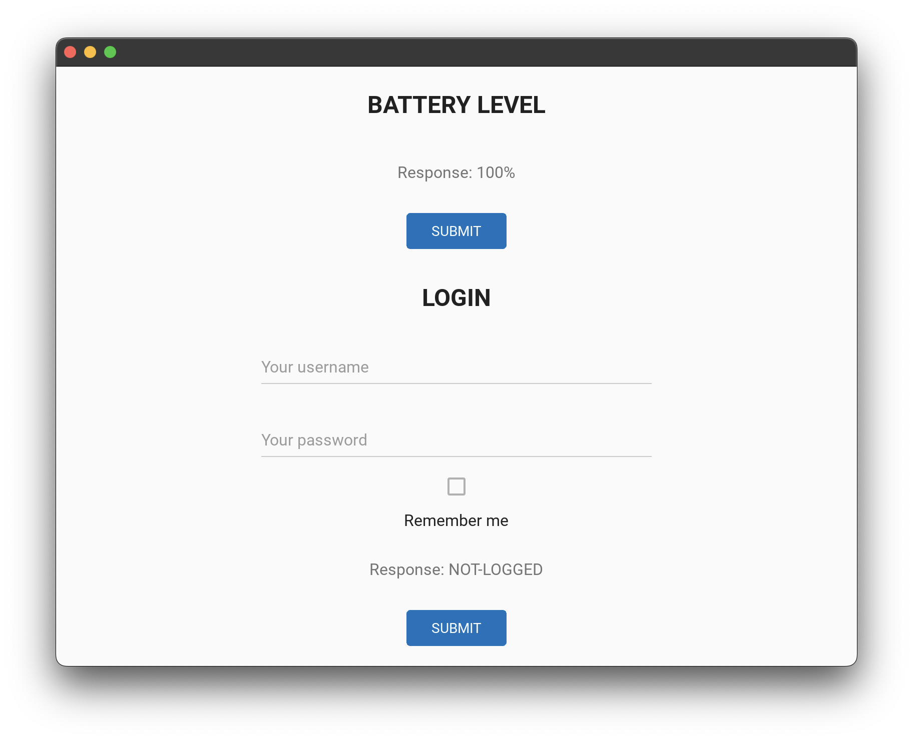
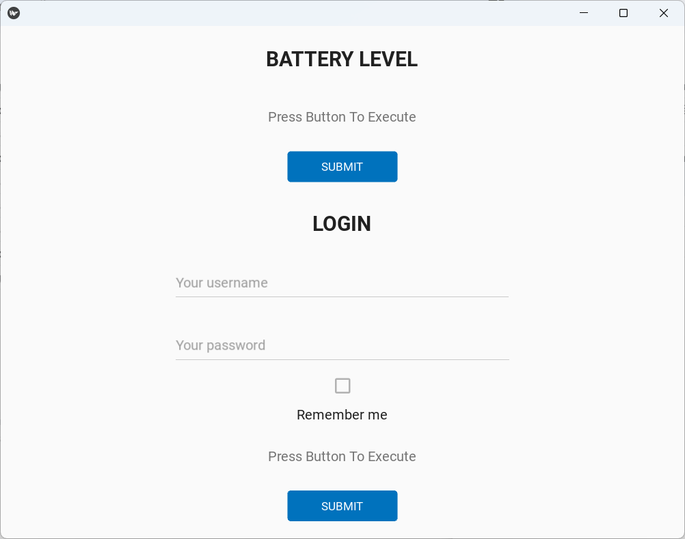
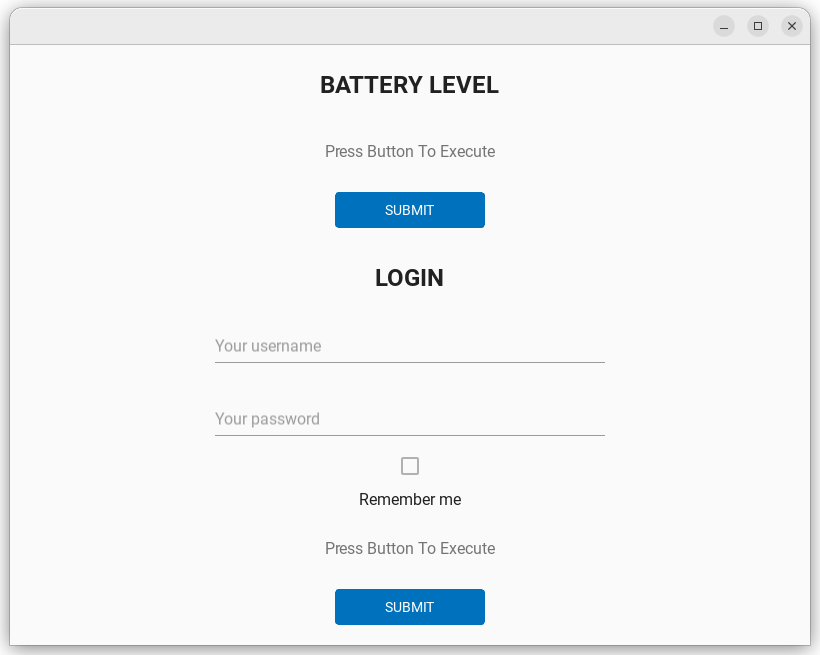

# Python

The Python package attaches Python to the router as a layer through the C abi, so a call from Python reaches a mapping in any language and a mapping written in Python is reachable from all of them.

## Requirements

* Python version 3.11 or later

## How to build the shared library

Execute on terminal:

```
python3 xplpc.py c-build-shared
```

or

```
cmake -S . -B build/c-shared/<arch> -DXPLPC_TARGET=c-shared -DXPLPC_ADD_CUSTOM_DATA=ON
cmake --build build/c-shared/<arch>
```

The `<arch>` directory is `arm64` or `x86_64`, matching the machine, since that is where `python-build`, `python-test` and `python-run-sample` look for the library.

## How to install the Python package

Build the C shared library before installing or building the Python package. It carries this repository's sample mappings unless `c-build-shared` is given `--custom-data-path` naming a directory of your own, as the C++ guide describes.

To utilize the default behavior, which installs the development package, execute the following command in the terminal:

```
python3 xplpc.py python-install
```

To build a wheel package and install that instead, which is what a consumer receives:

```
python3 xplpc.py python-build
python3 xplpc.py python-install --wheel
```

The wheel is written to `build/python/dist`.

The wheel carries the native library inside the package, and that is where the library is loaded from. The development package carries none, so `python-test` and `python-run-sample` name the one this checkout built through `XPLPC_LIBRARY_PATH`. An application that ships the library somewhere else sets the same variable to the full path of the file:

```
export XPLPC_LIBRARY_PATH=/opt/my-app/lib/libxplpc.so
```

Running the suite with `pytest` directly needs that variable too, since nothing else tells the package where the library is.

## How to run the Python sample

Install the Python package before running the Python sample.

Install the sample dependencies:

```
python3 -m pip install -r python/sample/src/requirements.txt
```

Run the sample executing on terminal:

```
python3 xplpc.py python-run-sample
```

## How to run the Python sample with PyInstaller

PyInstaller packages the sample from an environment of its own, since it cannot find the `xplpc` package inside the one the development install uses.

Build the Python package so Poetry finds it in the `build/python` folder:

```
python3 xplpc.py python-build
```

Install Poetry before packaging the sample:

```
python3 -m pip install -r python/sample/pyinstaller/requirements.txt
```

Execute PyInstaller:

```
python3 xplpc.py python-pyinstaller
```

You can execute the binary inside folder `build/pyinstaller`.

## How to run the Python tests

Install the Python package before running the Python tests.

Execute on terminal:

```
python3 xplpc.py python-test
```

## How to format the Python code

Execute on terminal:

```
python3 xplpc.py python-format
```

## Bringing the library up

Nothing runs on its own here, so the library is initialized with the serializer it carries before the first call:

```python
from xplpc.core.config import Config
from xplpc.core.xplpc import XPLPC
from xplpc.serializer.json_serializer import JsonSerializer

XPLPC().initialize(Config(JsonSerializer()))
```

Initializing loads the native library and attaches Python to the router as a layer. The router itself is built the first time anything uses it and lives until the process ends, with the C++ mappings registered before any host attaches. The Python layer detaches when the interpreter exits.

Python can be entered from any thread, so a call to one of its mappings runs on whichever thread it arrived on rather than being queued anywhere.

## Registering a mapping

A mapping is registered by name, which is what makes it reachable from any other language:

```python
from xplpc.data.mapping_list import MappingList
from xplpc.map.mapping_item import MappingItem

MappingList().add("platform.battery.level", MappingItem(battery_level))
```

Registering declares the name to the router, so it raises rather than registering into a layer that is not there when the library has not been brought up yet. `MappingList().clear()` takes back every name Python registered.

## The last registration wins

Every language registers into the same router, so when two of them register the same name, the one that registered it last receives every call to it. Taking a registration back gives the name to the layer that registered it before.

The C++ mappings are registered before any host attaches. C++ can serve `http.request`, an Android layer can register the same name and take it over, and a Flutter layer in that application can take it from both. When the Flutter layer goes away the name goes back to Android, and when Android takes its registration back the name goes back to C++. A Python layer follows the same rule, so a name Python registered goes back to the layer that registered it before once Python takes it back or the interpreter exits.

## Making a call

There are three ways to make a call and they differ in how the answer reaches you.

`call` hands the answer to a callback:

```python
request = Request(
    "sample.login",
    [
        Param("username", "paulo"),
        Param("password", "123456"),
        Param("remember", True),
    ],
)

Client.call(request, lambda response: print(response), str)
```

`call_async` hands it to what the language waits on:

```python
response = await Client.call_async(request, str)
print(response)
```

`call_async` always gives control back before the answer arrives. `call` returns before the answer whenever the mapping needs time, and runs the callback before it returns when the mapping answered at once. Each has a variant taking the encoded request instead of a `Request`, named `call_from_string` and `call_async_from_string`.

The callback runs on the thread that produced the answer, which is the mapping's thread when the mapping answered later. Anything it touches has to be safe there.

A mapping that answers right away runs the callback on the calling thread, where code that is not safe on another thread happens to work. Treating the callback as if it always ran elsewhere is what keeps it working when that mapping later starts answering from a thread of its own.

`call_sync` answers with the value itself, and `call_sync_from_string` takes the encoded request:

```python
response = Client.call_sync(request, str)
print(response)
```

It reads an answer that is already there rather than waiting for one, so it works only when the mapping answers before it returns. A call the mapping had not answered by then is cancelled and reported, so its later answer resolves nothing, and you are answered the empty value. It never blocks a thread, which is why there is no timeout to pass and no deadlock to reach.

Whether a mapping answers before it returns belongs to the mapping rather than to the call site, and that mapping may be written in another language by somebody else. A call that works today answers empty the day that mapping starts doing real work, so `call_sync` is for reading something you know is a plain read.

The empty value is also what a mapping with nothing to answer produces, so the two are told apart by the log and not by the value.

A callback that raises is reported through the log and is never called a second time, so a failure in your own code does not reach it again as an empty answer.

## Reading the answer as a class

The type you pass decides what the answer becomes. A value that already is that type is answered as it is, an integer is answered as a float when the float holds it exactly, and a boolean is never read as a number. An object fills the class you named, which can be a dataclass, a class whose constructor takes the fields as arguments, or a class with slots:

```python
@dataclass
class Todo:
    id: int
    title: str
    done: bool = False


todo = Client.call_sync(Request("sample.todo.single", [Param("item", item)]), Todo)
```

A dataclass or a class with slots ignores a field it does not declare, the way every other bridge decodes an object, and any other class receives every field that its constructor does not take as an attribute, which is how a class with no fields declared is filled at all. An object that cannot fill the class, such as one missing a field the constructor requires, is reported and answered as `None`. A list answers `None` as well, since a list cannot fill an object and filling one element at a time would be guessing at a type the wire never carried. A class with `from_json` reads whatever the wire carried itself, which is how a `DataView` reads anything that is not a handle as naming no buffer. The [types guide](types.md) has every type and what each language reads it as.

## Making the same call from a document

Every entry point has a second form that takes the request already serialized and answers the
response document rather than a decoded value. It is what serves a host that received a document
from somewhere else and has nothing to decode it against, which is how the bridges themselves call
in.

The difference in the answer is the whole of it. A typed call says a value is absent the way this
language says it, and a call from a document answers the empty string, since a document is either
there or it is not.

```python
Client.call_from_string(request_data, lambda response: print(response))

answer = Client.call_sync_from_string(request_data)

awaited = await Client.call_async_from_string(request_data)
```

## When no mapping answers

Every call is answered exactly once, and a call no mapping can answer is answered with `None`, or the empty string for a call from a document, rather than left waiting:

| Situation | What the caller receives |
| --- | --- |
| No layer registered the name | The empty value at once, and the failure is reported |
| The request could not be read | The empty value at once, and the failure is reported |
| The mapping raised | The empty value, and the failure is reported |
| The layer serving the call detached | The empty value, and the name goes back to the layer that registered it before |
| The call was cancelled | Nothing through a callback, since a cancelled call never calls back, and `call_sync` answers `None` |

A call made before `XPLPC().initialize` writes one line saying the library was not initialized and raises `RuntimeError`, since a caller that forgot to bring the library up is a mistake in the program rather than a failing call.

A Python call is cancelled by cancelling the task that awaits `call_async`, which raises `CancelledError` there as it does for any other await, and by `call_sync` when the mapping had not answered.

## Writing a mapping

A mapping is handed a message and something to answer through, and the one rule is to return quickly. Where the work runs is your decision.

Answering right away is fine when there is nothing slow to do:

```python
def battery_level(m, r):
    r(f"100{m.get('suffix') or ''}")
```

Anything that takes time goes to a thread of your own, and the answer is given from there:

```python
def ip(m, r):
    def work():
        try:
            body = urllib.request.urlopen("https://httpbin.io/ip").read().decode()
        except Exception:
            body = None

        r(body)

    threading.Thread(target=work, daemon=True).start()
```

The mapping runs on whichever thread the call arrived on. Doing slow work there instead of handing it to a thread holds that thread for as long as the work takes, which is what the rule above is about.

A call resolves once, so a mapping that answers twice, or answers and then raises, reaches the caller a single time. A request that names the same parameter twice, or carries a parameter name that is not text, is refused before any mapping runs, on every bridge.

## Sending a large buffer

A `DataView` names a buffer by a handle, so a large buffer crosses without being copied or encoded, and the wire carries `{"buffer":<handle>}` and never an address. `create_from_byte_buffer` registers a writable buffer such as a `bytearray`, and the layer holds it until the view is released, which is what keeps the source from moving or being freed while a mapping reads it:

```python
data = bytearray(read_something())
view = DataView.create_from_byte_buffer(data)

try:
    request = Request("sample.image.grayscale.dataview", [Param("dataView", view)])
    print(Client.call_sync(request, str))
finally:
    view.release()
```

The view is released once the call answered. `call` and `call_async` return before a mapping that takes time answers, so a view sent through them is released from the callback or after the await rather than straight after the call. A cancel ends the call without stopping the mapping, which includes a cancelled `call_async` and `call_sync` giving up on a mapping that had not answered, so after one the view is released only once the mapping is done with it. A view that is never released keeps its source for the life of the process.

Reading a value never names a type on this bridge, so a data view parameter reaches a mapping as the dictionary the wire carried and `DataView.from_json` turns it into a view. A value that is not a data view is reported and answered as an empty view rather than raising:

```python
def image_size(m, r):
    view = DataView.from_json(m.get("image"))
    r(len(ByteArrayHelper.create_from_data_view(view)))
```

`create_from_data_view` answers a copy of the bytes while their owner keeps them registered, and an empty result for a view whose buffer was released, was never registered or carries a handle that names nothing any more, and reports the refusal.

Only the side that registered a buffer can release it, so `release` answers false for a view you received, and a mapping that answers with a view keeps it registered after it returns, since the caller reads it once the call has unwound.

## Logging

The library reports every failing path. An error names what failed and where, and is always reported. A debug line carries the reason behind it, including the message the parser produced, and is off until you ask for it.

The library writes to a logger named `XPLPC`, and your application decides the level and where it goes:

```python
import logging

logging.basicConfig()
logging.getLogger("XPLPC").setLevel(logging.DEBUG)
```

## Sample project

You can see the sample project in directory `python/sample`.






