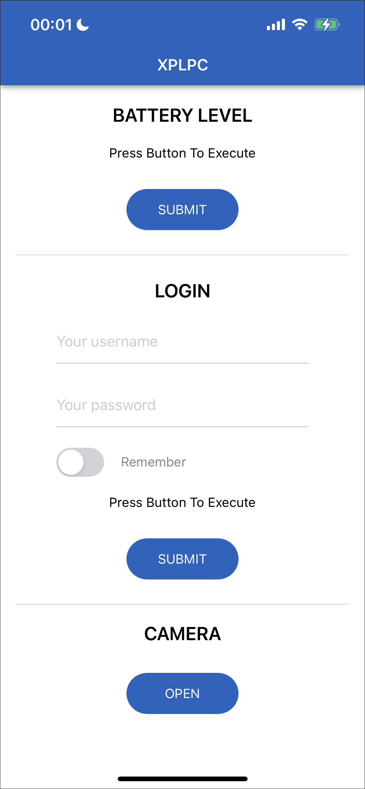
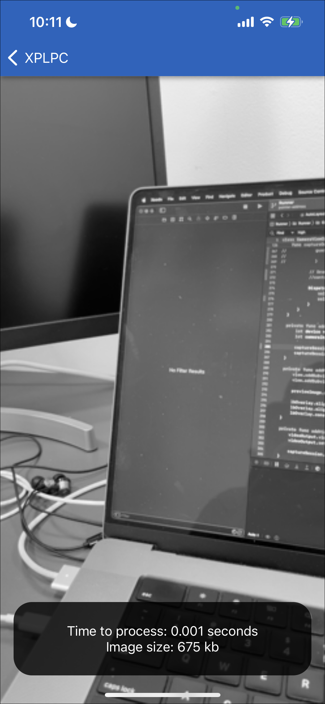

# Swift

The Swift library is a framework that attaches Swift to the router as a layer, so a call from Swift reaches a mapping in any language and a mapping written in Swift is reachable from all of them.

## Requirements

* Xcode
* Command Line Tools
* XcodeGen, for the sample project and the suite on a simulator or a device, which `python3 xplpc.py brew` installs with the other tools of the `Brewfile`

Make sure that you have installed both `Xcode` and `Command Line Tools` on your system.

To download `Xcode` from Apple, please visit the following link: https://apps.apple.com/us/app/xcode/id497799835.

Once installed, open the terminal and execute the command `xcode-select --install` to install the `Command Line Tools`.

The framework is built for iOS 15, tvOS 15, watchOS 9, Mac Catalyst 15 and macOS 12, which are the oldest versions the current Xcode can target. Mac Catalyst 15 is the release that runs on macOS 12. They are declared in `core/targets` and read from there by both the build and the Swift package, and every entry point is available on all of them.

## How to build the library for Swift

Execute on terminal:

```
python3 xplpc.py swift-build --platform=ios
```

The task builds every slice of the platform into a directory of its own under `build/swift-ios`, grouped by the platform each slice belongs to, which is the layout the XCFramework task reads.

## How to build the XCFramework package for iOS, tvOS, watchOS and macCatalyst

Execute on terminal:

```
python3 xplpc.py swift-build-xcframework --platform=ios
```

The task merges the slices of each group into one framework with `lipo`, merges their Swift modules beside it and assembles the groups into `build/swift-ios-xcframework/xplpc.xcframework`, which is why it has no manual equivalent.

Every framework in the xcframework carries a dSYM read from its own binary, so the uuid a crash report names is the one the dSYM answers for. Xcode copies it beside the application's own dSYM when it builds and when it archives, which is where a crash reporter such as Crashlytics takes it from to turn an address inside the library into a function, a file and a line. The binary keeps no debug map, since that names files on the machine that built it, and every framework is signed ad hoc, which the application replaces with its own signature when it embeds it.

The Catalyst slices are built through a scheme, since `xcodebuild` honours a destination only when it is given one, and a target build discards the `-macabi` triple and writes a plain macOS binary under a Catalyst name, which links and passes and is reported by nothing. The task reads every slice back with `vtool -show-build` and stops when the platform is not the one the slice declares.

## How to publish a Swift Package

A consumer that reaches the library through Swift Package Manager gets a binary target, so the package points at an archive rather than at these sources.

Build every Apple slice into one xcframework, then generate the package:

```
python3 xplpc.py swift-build --platform=apple
python3 xplpc.py swift-build-xcframework --platform=apple
python3 xplpc.py swift-generate-spm-package --url=https://example.com/main-<commit>/xplpc.xcframework.zip
```

The url is where the archive will be published and the task refuses to run without one, since this project publishes no release asset and the place belongs to whoever ships the package.

That writes `build/swift-apple-xcframework/xplpc.xcframework.zip` and, beside it, a `Package.swift` carrying its checksum. Both are build output and neither is committed. Publish the archive to the exact url the package names, since Swift Package Manager refuses an archive whose bytes do not match what the package declares, and regenerate both whenever either one changes.

The package covers iOS, iOS simulator, tvOS, tvOS simulator, watchOS, watchOS simulator, Mac Catalyst and macOS. The `apple` platform exists for this and carries all of them at once, which is what a single binary target needs, since building `ios` and `macos` separately produces two xcframeworks and neither one is enough.

The supported platforms are read from the same target definitions the build uses, so raising a deployment target in `core/targets` is carried into the package by regenerating it.

The manifest itself comes from `swift/spm/Package.swift.in`, which is the file to edit when the package has to declare something new.

## How to run the Swift tests

Execute on terminal:

```
python3 xplpc.py swift-test
```

The same suite also runs on an iOS simulator, against the shipped xcframework rather than the sources:

```
python3 xplpc.py swift-build --platform=ios
python3 xplpc.py swift-build-xcframework --platform=ios
python3 xplpc.py swift-test --platform ios
```

And on a connected iPhone, which signs the sample rather than skipping it:

```
python3 xplpc.py swift-test --platform ios-device
```

## How to run the Swift tests under a sanitizer

The tests on macOS are an XCTest bundle the runner opens with `dlopen`, and address and thread both need their runtime in the process before it starts, so only undefined runs there:

```
python3 xplpc.py swift-test --sanitizer undefined
```

Thread is reachable on the simulator instead, because xcodebuild launches the host application and can instrument it. It has no runtime for a device triple, so the library is built from the simulator slices alone:

```
python3 xplpc.py swift-build --platform ios-simulator --sanitizer thread
python3 xplpc.py swift-build-xcframework --platform ios-simulator
python3 xplpc.py swift-test --platform ios --sanitizer thread
```

Address reaches the simulator the same way:

```
python3 xplpc.py swift-build --platform ios-simulator --sanitizer address
python3 xplpc.py swift-build-xcframework --platform ios-simulator
python3 xplpc.py swift-test --platform ios --sanitizer address
```

## How to build the iOS sample

The Xcode project is generated from `project.yml` and regenerated before every build, so it cannot drift from the spec:

```
python3 xplpc.py swift-build-sample
```

Generating it without building is the same step on its own, which is what to run before opening the project in Xcode:

```
python3 xplpc.py swift-generate-sample-project
```

## How to format the Swift code

Execute on terminal:

```
python3 xplpc.py swift-format
```

## Build parameters

You can build this target using some parameters to change configuration:

**Your own C++ mappings in place of `cxx/custom`, read by `swift-build`, as the C++ guide describes:**

```
--custom-data-path=/path/to/your/mappings
```

**Platform:**

```
--platform ios
```

Platforms available: `apple`, `ios`, `ios-simulator`, `macos`, `ios-flutter`, `macos-flutter`, `test`

The `ios-device` platform is accepted by `swift-test` alone, since it names a connected device rather than a set of slices to build.

**Build type:**

```
--build debug
```

**Enable C interface:**

```
--interface
```

**Incremental, keeping what a previous build left:**

```
--incremental
```

**No dependencies:**

```
--no-deps
```

## Bringing the library up

The framework brings itself up when it loads, so there is nothing to call. Loading it attaches Swift to the router as a layer, and the router itself is built the first time anything uses it and lives until the process ends, with the C++ mappings registered before Swift attaches.

## Registering a mapping

A mapping is registered by name, which is what makes it reachable from any other language:

```swift
import xplpc

MappingList.shared.add(name: "platform.battery.level", item: MappingItem(target: batteryLevel))
```

Registering declares the name to the router, and `MappingList.shared.clear()` takes back every name Swift registered.

## The last registration wins

Every language registers into the same router, so when two of them register the same name, the one that registered it last receives every call to it. Taking a registration back gives the name to the layer that registered it before.

The C++ mappings are registered before any host attaches. C++ can serve `http.request`, an Android layer can register the same name and take it over, and a Flutter layer in that application can take it from both, and when the Flutter layer goes away the name goes back to Android. Swift takes the place of Android in an iOS application, so a name Swift registered goes back to C++ when Swift takes its registration back.

## Making a call

There are three ways to make a call and they differ in how the answer reaches you.

`call` hands the answer to a callback:

```swift
let request = Request(
    "sample.login",
    Param("username", "paulo"),
    Param("password", "123456"),
    Param("remember", true)
)

Client.call(request) { (response: String?) in
    print(response ?? "")
}
```

`callAsync` hands it to what the language waits on:

```swift
let response: String? = await Client.callAsync(request)
print(response ?? "")
```

The answer is decoded once the waiting task resumes, so the type it decodes into crosses to that task and has to be `Sendable`.

Cancelling the task that waits answers it with nil at once and cancels the call, whether or not the mapping ever answers. The mapping is not told, so work it started keeps running and its answer is dropped when it arrives.

`callAsync` always gives control back before the answer arrives. `call` returns before the answer whenever the mapping needs time, and runs the callback before it returns when the mapping answered at once. A `callAsync` awaited from a `@MainActor` context resumes on the main actor, which is what puts the answer back on the interface without any work from you.

The callback given to `call` runs on the thread that produced the answer, which is the mapping's thread when the mapping answered later. Anything it touches has to be safe there.

Touching a view from it is undefined, so anything that reaches the interface is handed to the main queue:

```swift
Client.call(request) { (response: String?) in
    DispatchQueue.main.async {
        self.label.text = response ?? ""
    }
}
```

A mapping that answers right away runs the callback on the calling thread, where the same code without that hop happens to work. Writing the hop anyway is what keeps it working when that mapping later starts answering from a thread of its own.

`callSync` answers with the value itself:

```swift
let response: String? = Client.callSync(request)
print(response ?? "")
```

It reads an answer that is already there rather than waiting for one, so it works only when the mapping answers before it returns. A call the mapping had not answered by then is cancelled and reported, so its later answer resolves nothing, and you are answered the empty value. It never blocks a thread, which is why there is no timeout to pass and no deadlock to reach.

Whether a mapping answers before it returns belongs to the mapping rather than to the call site, and that mapping may be written in another language by somebody else. A call that works today answers empty the day that mapping starts doing real work, so `callSync` is for reading something you know is a plain read.

The empty value is also what a mapping with nothing to answer produces, so the two are told apart by the log and not by the value.

## Making the same call from a document

Every entry point has a second form that takes the request already serialized and answers the
response document rather than a decoded value. It is what serves a host that received a document
from somewhere else and has nothing to decode it against, which is how the bridges themselves call
in.

The difference in the answer is the whole of it. A typed call says a value is absent the way this
language says it, and a call from a document answers the empty string, since a document is either
there or it is not.

```swift
Client.call(requestData) { (response: String) in
    print(response)
}

let answer = Client.callSync(requestData)

let awaited = await Client.callAsync(requestData)
```

## When no mapping answers

Every call is answered exactly once, and a call no mapping can answer is answered with the empty value rather than left waiting:

| Situation | What the caller receives |
| --- | --- |
| No layer registered the name | The empty value at once, and the failure is reported |
| The request could not be read | The empty value at once, and the failure is reported |
| The mapping raised | The empty value, and the failure is reported |
| The layer serving the call detached | The empty value, and the name goes back to the layer that registered it before |
| The call was cancelled | Nothing through a callback, since a cancelled call never calls back, and `callSync` and a cancelled `callAsync` answer nil |

A Swift call is cancelled by cancelling the task that awaits `callAsync`, which answers that task with nil, and by `callSync` when the mapping had not answered. The Swift layer stays attached for the life of the process.

## Writing a mapping

A mapping is handed a message and something to answer through, and the one rule is to return quickly. Where the work runs is your decision.

Answering right away is fine when there is nothing slow to do:

```swift
func batteryLevel(message: Message, r: @escaping Response) {
    let suffix: String = message.get("suffix") ?? ""

    r("100\(suffix)")
}
```

Anything that takes time is started and left running, and the answer is given when it finishes:

```swift
func ip(message: Message, r: @escaping Response) {
    guard let url = URL(string: "https://httpbin.io/ip") else {
        r(nil)
        return
    }

    URLSession.shared.dataTask(with: url) { data, _, _ in
        r(AnyCodable(String(data: data ?? Data(), encoding: .utf8) ?? ""))
    }.resume()
}
```

The mapping runs on whichever thread the call arrived on. Doing slow work there instead of handing it to a queue holds that thread for as long as the work takes, which is what the rule above is about. The responder is `Sendable`, so carrying it to the thread that finishes the work needs nothing from you.

A value is read with the type you ask for, whether it stands alone or sits inside a list, a dictionary or a type of your own, and a number is converted into any numeric type that holds it exactly, with a fraction rounded to the nearest value a floating type holds and a magnitude past that type refused rather than read as infinity. A json `42` reads as `Int8`, `UInt8`, `Int64` or `Double`, a `128` does not read as `Int8`, a fraction does not read as an integer, and a boolean and a number never read as each other. A value that does not fit what you asked for answers nil and is reported: The [types guide](types.md) has every type and what each language reads it as.

```swift
let level: Int8? = message.get("level")
```

A request naming the same parameter twice is refused before any mapping runs, since there is no rule every language would agree on for which of the two it meant.

## Sending a large buffer

A `DataView` names a buffer by a handle, so a large buffer crosses without being copied or encoded, and the wire carries `{"buffer":<handle>}` and never an address. Swift storage has no fixed address, so `withByteArray` registers the bytes for as long as its closure runs and releases them when it returns, and the view must not escape it:

```swift
var bytes: [UInt8] = readSomething()

let processed: [UInt8] = DataView.withByteArray(&bytes) { view in
    let request = Request("sample.image.grayscale.dataview", Param("dataView", view))
    let response: String? = Client.callSync(request)

    return response == nil ? [] : ByteArrayHelper.createFromDataView(view)
}
```

The buffer has to stay registered for the whole call and not only for the closure, since a mapping reads it while it works. `callSync` answers before the closure returns, which is why it is the call to make here, and a mapping that needs time to work on a buffer cannot be handed one this way.

Reading one goes through `ByteArrayHelper`, which answers a copy of the bytes while their owner keeps them registered, and an empty array for a view whose buffer was released, was never registered or carries a handle that names nothing any more, with the refusal reported by the native buffer table:

```swift
let received: DataView? = Client.callSync(Request("sample.dataview"))
let copy = received.map(ByteArrayHelper.createFromDataView) ?? []
```

The closure is synchronous, so a view made this way reaches only a mapping that is done with the bytes by the time the call returns, and a mapping that keeps reading them after the closure returned reads memory that is gone.

Only the side that registered a buffer releases it, so a view you received is never released by you, and a mapping that answers with a view keeps its buffer registered after it returns, since the caller reads it once the call has unwound.

## Logging

The library reports every failing path. An error names what failed and where, is always reported and is written as public, since it carries names and never data, so it stays readable in a log collected from a device. A debug line carries the reason behind it, including the message the parser produced, is off until you ask for it and stays private.

Everything is written to the `XPLPC` subsystem through `os_log`, so errors show up with no setup and the debug level is enabled per subsystem when you want it:

```
sudo log config --subsystem XPLPC --mode "level:debug"
```

Then read it with:

```
log stream --predicate 'subsystem == "XPLPC"' --level debug
```

In Xcode, the same messages appear in the console, and Console.app shows them once "Include Debug Messages" is on.

## Sample project

You can see the sample project in directory `swift/sample`.




