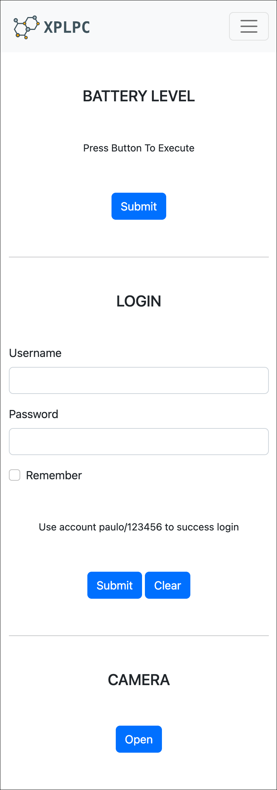

# WebAssembly (WASM)

The WebAssembly module carries the C++ core, and the TypeScript library in `wasm/sample/src/xplpc` attaches the page to its router as a layer, so a call from the page reaches a mapping in C++ and a mapping written in TypeScript is reachable from C++.

## Requirements

* Node JS
* NPM
* Emscripten

## Setup EMSDK variables

Execute on terminal inside your EMSDK installation folder:

```
source emsdk_env.sh
echo $EMSDK
```

Sourcing it puts `emsdk` and `emcc` on the path and sets `EMSDK`, which `wasm-build` reads to find the toolchain. Without it the build stops saying the sdk is not installed.

## How to build the library for WASM

Execute on terminal:

```
python3 xplpc.py wasm-build
```

or

```
cmake -S . -B build/wasm/wasm32 -DXPLPC_TARGET=wasm -DXPLPC_ADD_CUSTOM_DATA=ON -DCMAKE_TOOLCHAIN_FILE=${EMSDK}/upstream/emscripten/cmake/Modules/Platform/Emscripten.cmake -DCMAKE_BUILD_TYPE=Release
cmake --build build/wasm/wasm32
```

## How to build the WASM sample

Execute on terminal:

```
python3 xplpc.py wasm-build-sample
```

or

```
cd wasm/sample
npm ci
npm run build
```

## How to run the WASM sample

Execute on terminal:

```
python3 xplpc.py wasm-run-sample
```

or

```
cd wasm/sample
npm ci
npm run dev
```

## How to serve the WASM sample

Execute on terminal:

```
python3 xplpc.py wasm-serve-sample
```

or

```
cd wasm/sample
npm ci
npm run build
cd dist
python3 -m http.server
```

## How to test

Execute on terminal:

```
python3 xplpc.py wasm-test
```

The task does not build the module, so a change under `cxx`, `wasm/lib` or the bindings is only picked up after `python3 xplpc.py wasm-build`.

or

```
cd wasm/sample
npm ci
npm run test:unit
```

## How to format the WASM code

Execute on terminal:

```
python3 xplpc.py wasm-format
```

## Build parameters

You can build this target using some parameters to change configuration:

**Your own C++ mappings in place of `cxx/custom`, as the C++ guide describes:**

```
--custom-data-path=/path/to/your/mappings
```

**Build type:**

```
--build debug
```

**Incremental, keeping what a previous build left:**

```
--incremental
```

**No dependencies:**

```
--no-deps
```

**Instrumented module, with `address` or `undefined`, which `wasm-test` then runs against:**

```
--sanitizer address
```

## Online demo

You can see the online demo on URL:

<https://xplpc.github.io/wasm-demo/>

## Taking it into your own application

There is no package registry for this bridge, so the TypeScript side is source you copy and the
module is what the build produced. Three things move:

| What | Where it comes from | Where it goes |
| --- | --- | --- |
| The library | `wasm/sample/src/xplpc` | Your source tree |
| The module | `build/wasm/wasm32/bin/xplpc.js` and `xplpc.wasm` | Side by side in your source tree, such as `src/wasm` |
| The declaration | `wasm/sample/types/xplpc.d.ts` | Your `typeRoots`, with the module path rewritten |

The sample reaches the module through a Vite alias that points at this repository, which is why its
imports read `@xplpc/build/...`. In your application the module is imported like any other source
file, and it finds `xplpc.wasm` beside itself through `import.meta.url`, so the two stay together
where the bundler resolves sources rather than in a static folder such as Vite's `public`, which
refuses an import. The declaration names the same path.

The library compiles as part of your bundle rather than shipping prebuilt, which is why the debug
level follows your own build rather than a runtime setting. It reads `import.meta.env.DEV`, so it
needs Vite's client types, which the sample references in `src/env.d.ts`, or that value defined by
your own bundler.

## Bringing the library up

The module is loaded first and handed to the library along with the serializer it carries:

```typescript
import Module from "./wasm/xplpc.js";

Module().then((module: WasmModule) => {
    XPLPC.shared().initialize(module, new Config(new JsonSerializer()));

    Mapping.initialize();
});
```

Initializing attaches the page to the router as a layer. The router lives inside the module, is built the first time anything uses it and lasts as long as the module does, with the C++ mappings registered before the page attaches. `Mapping` is the sample's own class, and it registers that application's mappings the way the next section shows.

A call made before the module is up is reported and answered with nothing rather than waiting on a module that is not there.

Bringing the library up either completes or leaves nothing behind. Every step that can fail runs before the layer is attached, so an `initialize` that raises can simply be called again. The module keeps a handle of its own to the layer that reaches your mappings, so nothing on the page has to hold one alive.

## Registering a mapping

A mapping is registered by name, which is what makes it reachable from any other language:

```typescript
MappingList.shared().add(
    "platform.battery.level",
    new MappingItem(batteryLevel),
);
```

Registering declares the name to the router, so it raises when the library has not been brought up yet. `MappingList.shared().clear()` takes back every name the page registered.

## The last registration wins

Every language registers into the same router, so when two of them register the same name, the one that registered it last receives every call to it. Taking a registration back gives the name to the layer that registered it before.

The C++ mappings are registered before any host attaches. C++ can serve `http.request`, an Android layer can register the same name and take it over, and a Flutter layer in that application can take it from both. When the Flutter layer goes away the name goes back to Android, and when Android takes its registration back the name goes back to C++. In the browser the page is the only host, so a name the page registers takes it from C++, and clearing it gives it back.

## Making a call

A call is awaited, and the answer reaches you through the promise it returns:

```typescript
const request = new Request(
    "sample.login",
    new Param("username", "paulo"),
    new Param("password", "123456"),
    new Param("remember", true),
);

const response = await Client.call<string>(request);
console.log(response);
```

Control goes back to the event loop before the answer arrives, so nothing else on the page is held up. There is one entry point rather than two, since a promise is both shapes at once and takes a callback through `then`.

`callSync` answers with the value itself:

```typescript
const response = Client.callSync<string>(request);
console.log(response);
```

It reads an answer that is already there rather than waiting for one, so it works only when the mapping answers before it returns. A call the mapping had not answered by then is cancelled and reported, so its later answer resolves nothing, and you are answered `undefined`. It never blocks, which is why there is no timeout to pass and no deadlock to reach.

On this bridge that means the mappings the module owns and never the ones you wrote. A mapping here answers with a promise, which resolves in a microtask and so never inside the call, so `callSync` on a name this page owns always answers `undefined`. Reaching one of your own mappings is what `call` is for.

`undefined` is also what a mapping with nothing to answer produces, so the two are told apart by the console and not by the value.

## Making the same call from a document

Every entry point has a second form that takes the request already serialized and answers the
response document rather than a decoded value. It is what serves a host that received a document
from somewhere else and has nothing to decode it against, which is how the bridges themselves call
in.

The difference in the answer is the whole of it. A typed call says a value is absent the way this
language says it, and a call from a document answers the empty string, since a document is either
there or it is not.

```typescript
const answer = await Client.call(requestData);

const immediate = Client.callSync(requestData);
```

There is no `callAsync` here for the reason there is none for a typed call, which is that `call`
already answers with a promise.

## When no mapping answers

Every call is answered exactly once, and a call no mapping can answer is answered with `undefined`, or the empty string for a call from a document, rather than left waiting:

| Situation | What the caller receives |
| --- | --- |
| No layer registered the name | The empty value at once, and the failure is reported |
| The request could not be read | The empty value at once, and the failure is reported |
| The mapping raised or its promise rejected | The empty value, and the failure is reported |
| The call was cancelled | `callSync` answers `undefined`, or the empty string for a call from a document, and the cancelled call's later answer resolves nothing |

A promise cannot be cancelled, so the one call that is cancelled here is `callSync` when the mapping had not answered. The page stays attached for as long as the module lives.

## Writing a mapping

A mapping answers with a promise, so waiting is what it already does:

```typescript
function batteryLevel(message: Message): Promise<string> {
    return Promise.resolve("100" + (message.get<string>("suffix") ?? ""));
}
```

Anything that takes time is the same shape, since a promise is what the caller already waits on:

```typescript
function ip(): Promise<string> {
    return fetch("https://httpbin.io/ip").then((response) => response.text());
}
```

The module runs on the one thread JavaScript gave it, so a mapping that does slow synchronous work holds the page for as long as it takes. Returning a promise and letting the work finish on its own is what keeps that from happening.

## Sending a large buffer

A `DataView` names a buffer by a handle, so a large buffer crosses without being copied or encoded, and the wire carries `{"buffer":<handle>}` and never an address. Here the view copies the bytes into the wasm heap and registers them, and it owns both until it is released with `DataView.free`, which ignores a view it did not allocate:

```ts
const view = DataView.createFromArrayBufferView(bytes);

try {
    const request = new Request("sample.image.grayscale.dataview", new Param("dataView", view));
    const response = await Client.call<string>(request);

    console.log(response ?? "");
} finally {
    DataView.free(view);
}
```

The view is released only once the call answered, which is why the call is awaited.

The bytes are read in place in the heap rather than copied, and they are never handed out, because the wasm heap grows into a new buffer and detaches every typed array taken from the old one, so a stale array reports length zero instead of failing. `withUint8Array` and `withUint8ClampedArray` build the array from the current buffer and pass it to a body where it cannot outlive the read:

```ts
DataView.withUint8Array(view, (processed) => {
    console.log(processed.length);
});
```

A view that arrives in an answer is the object the wire carried, and `DataView.fromJSON` turns it into a view:

```ts
const received = DataView.fromJSON(await Client.call<unknown>(new Request("sample.dataview")));
```

A view whose buffer was released, was never registered or carries a handle that names nothing any more reads as no bytes and is reported, and a value that is not a data view is reported and read as that same empty view. A view that could not be allocated is the empty view too, and the failure is reported. An empty source produces that same empty view without allocating anything. Copying bytes that already live in the heap works as well, since they are taken out before the allocation that can grow the heap and detach them.

Only the side that registered a buffer can release it, so `DataView.free` does nothing to a view you received, and a mapping that answers with a view keeps it registered after it returns, since the caller reads it once the call has unwound.

## Integers past the safe range

A JavaScript number is a double, so an integer past `Number.MAX_SAFE_INTEGER` is rounded the moment it is parsed. The serializer refuses such a value rather than handing a different one to your code, and the call is answered with `undefined`. A runtime that gives the parser the original text lets it refuse only the integers it would round. One that does not, which is Safari before 18.4, leaves nothing to tell `9007199254740993` from `1e300`, so every whole valued number past the safe range is refused there. A field that genuinely needs the full 64 bit range crosses as a string.

## Values the wire has no shape for

The wire carries a date as whole milliseconds since the unix epoch and binary data as a view, so a `Date`, a `Map`, a `Set`, an `ArrayBuffer` or a typed array handed to a call or answered by a mapping is refused and reported rather than written in the shape `JSON.stringify` gives it, and the call is answered with `undefined`. Send `date.getTime()`, a plain object or a list, and a `DataView` for bytes. A parameter without a value and a mapping that answers nothing both travel as `null`. The [types guide](types.md) has every type and what each language reads it as.

## Logging

The library reports every failing path. An error names what failed and where, and is always reported. A debug line carries the reason behind it, including the message the parser produced, and is off until you ask for it.

Errors go to `console.error` and are always reported. The debug level is kept for a development build only, so `npm run dev` shows it and a production bundle does not.

Every line starts with `[XPLPC]`, which is what the other bridges get from a named logger and what the browser console has instead of one, so filtering on it in the devtools console shows or hides this library without touching your own.

## Sample project

You can see the sample project in directory `wasm/sample`.


